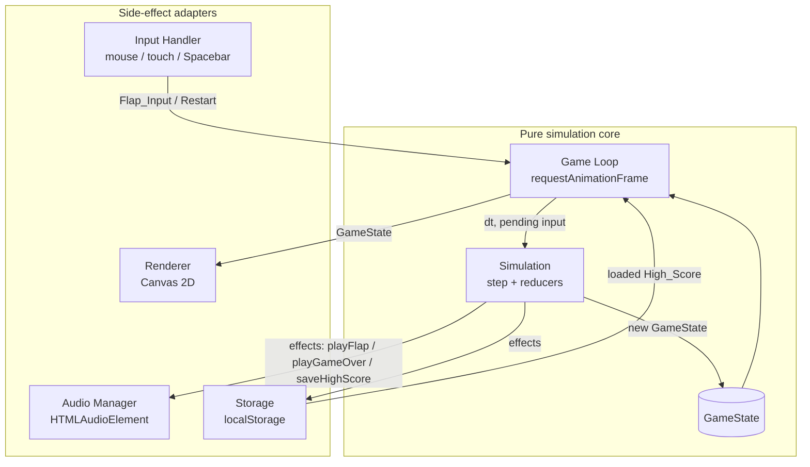
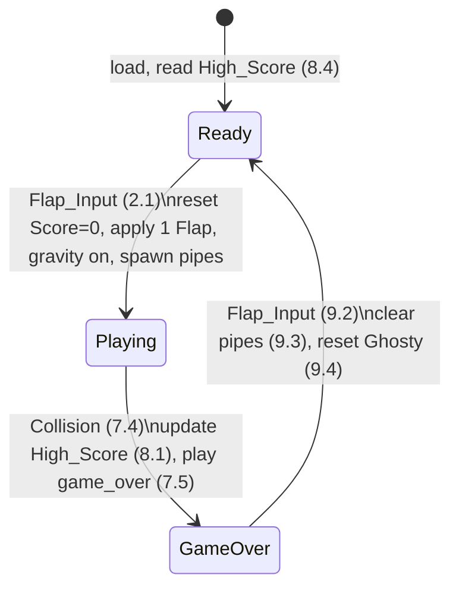

# Design Document

## Overview

Flappy Kiro is a browser-based, Flappy Bird-style arcade game. The player taps, clicks, or presses Spacebar to make a white ghost character (Ghosty) flap upward against constant gravity, steering through gaps in horizontally scrolling green pipes. The player scores one point per pipe passed, and the best score persists across sessions.

### Technology Choice

The design uses **HTML5 Canvas + vanilla JavaScript (ES modules)** with no runtime framework or build step. Rationale:

- The workspace has no existing framework, and the requirements describe a single-screen, frame-driven arcade game — a canvas render loop is the natural fit.
- Vanilla JS keeps the project dependency-light and runnable by opening `index.html` directly in a browser (requirement set is fully client-side).
- `localStorage` satisfies the High_Score persistence requirements (8.2, 8.4) without any server.
- `requestAnimationFrame` drives the game loop; the Web Audio-free `HTMLAudioElement` API plays the two `.wav` assets.

The one architectural decision worth highlighting: **game simulation logic is kept pure and separated from rendering, input, audio, and storage.** The simulation advances via a pure `step(state, input, dt)` function that returns a new state. This separation makes the core logic deterministic and directly testable with property-based tests (the DOM, canvas, and audio are side-effect adapters around the pure core).

### Mapping to Assets

| Asset | Use |
| --- | --- |
| `assets/ghosty.png` | Ghosty sprite (Req 10.1) |
| `assets/jump.wav` | Flap sound (Req 4.2) |
| `assets/game_over.wav` | Game over sound (Req 7.5) |
| `img/example-ui.png` | Visual reference: light blue sky, clouds, green pipes, bottom score bar `Score: 2 | High: 2` (Req 10.2, 10.3) |

## Architecture

The application is split into a **pure simulation core** and a set of **side-effect adapters** (rendering, input, audio, storage). The core never touches the DOM; adapters never contain game rules.



### State Machine

The Game is a three-state machine (Req 1, 2, 7, 9). Transitions are driven by Flap_Input and by Collision events.



State responsibilities:

- **Ready_State** (Req 1): Ghosty is drawn at a fixed start position and held stationary (1.2, 1.6). Score shows 0 (1.4). Background with clouds and High_Score are shown (1.3, 1.5).
- **Playing_State** (Req 3, 5, 6): gravity, pipe scrolling, spawning, collision checks, and scoring all run each frame.
- **Game_Over_State** (Req 7.7–7.9, 9.1): pipes frozen, Ghosty frozen, Flap_Input ignored for movement, restart prompt shown.

### Game Loop

A single `requestAnimationFrame` loop runs continuously:

1. Compute `dt` (seconds) from the timestamp delta, clamped to a maximum (e.g. 1/30s) to avoid large jumps when the tab is backgrounded.
2. Drain any pending input event collected since the last frame into an `input` descriptor.
3. Call `state = step(state, input, dt)`, which returns a new `GameState` and a list of `effects`.
4. Execute `effects` through the adapters (play sound, save high score).
5. Call `render(ctx, state)`.

Simulation is **fixed-logic, variable-dt**: physics integrate with the frame `dt`. All tunable constants (gravity, flap velocity, scroll speed, gap size, spacing) are collected in a single `Config` object so they are deterministic and testable.

## Components and Interfaces

### 1. Simulation Core (`src/sim.js`) — pure, no side effects

```text
createInitialState(config, highScore) -> GameState
    Builds a Ready_State with Ghosty at start position, Score 0, given High_Score.

step(state, input, dt) -> { state: GameState, effects: Effect[] }
    Pure reducer. Dispatches on state.phase:
      - Ready:    if input.flap -> startGame()
      - Playing:  applyFlap? -> integrate gravity -> move/spawn/despawn pipes
                  -> score passed pipes -> detect collision -> maybe GameOver
      - GameOver: if input.flap -> transition to Ready (restart)

Effect = { type: 'playFlap' }
       | { type: 'playGameOver' }
       | { type: 'saveHighScore', value: number }
```

`step` returns effects as data rather than performing them, keeping it pure. The loop interprets effects. This is what lets property tests assert on both state transitions and the effects emitted (e.g. "a Flap emits exactly one playFlap effect").

Internal reducers (all pure):

- `startGame(state)` — Req 2: Score→0, apply one Flap, gravity active next frame, spawn initial Pipe_Pair(s) at/beyond right edge, emit `playFlap`.
- `applyGravity(ghosty, dt, config)` — Req 3.1, 3.2.
- `applyFlap(ghosty, config)` — Req 4.1.
- `advancePipes(pipes, dt, config)` — Req 5.1 move left; Req 5.5 despawn when fully past left edge; Req 5.6 spawn to maintain fixed spacing.
- `spawnPipePair(config, rng)` — Req 5.2 randomized gap center within margins; Req 5.3 fixed gap height.
- `scorePassedPipes(state)` — Req 6.1: increment once per pipe whose trailing edge crosses Ghosty's x.
- `detectCollision(ghosty, pipes, config)` — Req 7.1–7.3 (pipes, ground, ceiling).
- `restart(state)` — Req 9.2–9.4: clear pipes, reset Ghosty, back to Ready, Score→0.

### 2. Random Source

`spawnPipePair` takes an injected `rng: () => number` (a function returning `[0,1)`). Production passes `Math.random`; tests pass a seeded generator. This keeps spawning deterministic under test while randomized in play (Req 5.2).

### 3. Input Handler (`src/input.js`) — adapter

Listens on the canvas/window and normalizes three sources into a single Flap_Input (Req 4.3):

- `mousedown` (mouse click)
- `touchstart` (touch tap) — calls `preventDefault` to suppress synthetic mouse/scroll
- `keydown` with `code === 'Space'` (Spacebar) — calls `preventDefault` to suppress page scroll

Each produces a `flap: true` on the next frame's input descriptor. The handler does not know the current phase; the simulation decides what a flap means per state (start / flap / restart / ignored-for-movement per Req 7.9 and 9.2).

### 4. Renderer (`src/render.js`) — adapter

`render(ctx, state)` draws, each frame (Req 10.4):

1. Light blue sky fill + cloud shapes (Req 1.3, 10.2) — clouds drawn as rounded white blobs matching the reference UI.
2. Pipe_Pairs: green top pipe from Ceiling to top of Gap, green bottom pipe from bottom of Gap to Ground (Req 5.4).
3. Ghosty sprite from `assets/ghosty.png` at its current position (Req 10.1).
4. Bottom score bar text `Score: {score} | High: {highScore}` (Req 6.2, 10.3), reading values straight from `state` so the display always reflects the same frame as the update (Req 6.3, 8.6).
5. In Game_Over_State, a restart prompt (Req 9.1).

The renderer is a pure function of `state` (plus loaded images) — it reads, never mutates. Score/High_Score are rendered from the current `state` so no separate "display" step can drift from the simulation.

### 5. Audio Manager (`src/audio.js`) — adapter

Preloads two `HTMLAudioElement`s. `playFlap()` and `playGameOver()` reset `currentTime` to 0 and call `play()`. `play()` returns a promise that may reject (autoplay policy, decode failure); the manager swallows rejections so audio never halts the game (Req 7.6). Game-over sound plays exactly once because the effect is emitted only on the single Playing→GameOver transition (Req 7.4, 7.5).

### 6. Storage (`src/storage.js`) — adapter

- `loadHighScore()` — reads key `flappyKiro.highScore` from `localStorage`; returns the parsed integer, or `0` when absent or unparseable (Req 8.4).
- `saveHighScore(value)` — writes the value; wrapped in try/catch so a storage failure (quota, disabled storage) is swallowed and play continues with the in-session value (Req 8.3).

### 7. Bootstrap (`index.html`, `src/main.js`)

`main.js` loads the High_Score, builds the initial state, wires input/audio/storage adapters, and starts the loop. `index.html` hosts a single `<canvas>` sized to the Play_Area and loads `main.js` as a module.

## Data Models

All simulation data is plain, serializable objects (no classes with hidden state), which keeps `step` pure and states easy to construct in tests.

```text
Config {
  width, height          // Play_Area pixel size
  groundY                // Ground boundary (Ceiling = 0)
  gravity                // downward acceleration (px/s^2)
  flapVelocity           // upward velocity set on Flap (negative, px/s)
  scrollSpeed            // pipe horizontal speed (px/s), fixed for session (5.1)
  gapHeight              // fixed Gap height, same for all pairs (5.3)
  gapMargin              // min margin from Gap to Ceiling and Ground (5.2)
  pipeWidth              // pipe horizontal thickness
  pipeSpacing            // fixed horizontal spacing between leading edges (5.6)
  ghostStartX, ghostStartY   // fixed start position (1.2)
  ghostWidth, ghostHeight    // collision bounds
  maxDt                  // frame-time clamp
}

Ghosty {
  x, y                   // top-left of collision box (x fixed; y varies)
  vy                     // vertical velocity (px/s)
}

PipePair {
  x                      // left edge of the pipe column (scrolls left)
  gapCenterY             // vertical center of the Gap (5.2)
  passed                 // boolean: already counted for Score (6.1)
}

GameState {
  phase                  // 'ready' | 'playing' | 'gameover'
  ghosty: Ghosty
  pipes: PipePair[]
  score                  // current Score (6)
  highScore              // High_Score (8)
}
```

Derived geometry (computed, not stored):

- Gap top = `gapCenterY - gapHeight/2`; Gap bottom = `gapCenterY + gapHeight/2`.
- Top pipe rect = `(x, 0, pipeWidth, gapTop)`; bottom pipe rect = `(x, gapBottom, pipeWidth, groundY - gapBottom)` (Req 5.4).
- Ghosty rect = `(ghosty.x, ghosty.y, ghostWidth, ghostHeight)` used for collision (Req 7.1).

Collision uses axis-aligned bounding-box (AABB) overlap between Ghosty's rect and each pipe rect, plus boundary checks `ghosty.y <= 0` (Ceiling, 7.3) and `ghosty.y + ghostHeight >= groundY` (Ground, 7.2).

## Correctness Properties

*A property is a characteristic or behavior that should hold true across all valid executions of a system — essentially, a formal statement about what the system should do. Properties serve as the bridge between human-readable specifications and machine-verifiable correctness guarantees.*

These properties target the pure simulation core (`createInitialState`, `step`, reducers, geometry helpers) and the pure helpers (`formatScore`, storage round-trip). Visual rendering (sky, clouds, sprite, prompt) and DOM event wiring are verified by example/integration tests, not properties (see Testing Strategy).

### Property 1: Initial state is a Ready screen

*For any* valid config and any loaded High_Score value, `createInitialState(config, highScore)` produces a state whose phase is `ready`, whose score is 0, whose highScore equals the loaded value, and whose Ghosty sits at the fixed start position (`ghostStartX`, `ghostStartY`).

**Validates: Requirements 1.1, 1.2, 1.4, 1.5, 8.5**

### Property 2: Ready holds Ghosty stationary

*For any* ready state and any frame `dt`, stepping with no Flap_Input leaves Ghosty's position and velocity unchanged.

**Validates: Requirements 1.6**

### Property 3: Flap starts the game

*For any* ready state, stepping with a Flap_Input produces a state whose phase is `playing` with score 0, with Ghosty's velocity set to `flapVelocity` (exactly one Flap applied), with at least one Pipe_Pair whose `x` is at or beyond the right edge of the Play_Area, and emits exactly one `playFlap` effect.

**Validates: Requirements 2.1, 2.2, 2.4, 2.5**

### Property 4: Gravity integration while playing

*For any* playing state and any `dt > 0`, stepping with no Flap_Input increases Ghosty's downward velocity by `gravity * dt` and updates Ghosty's vertical position according to its velocity.

**Validates: Requirements 2.3, 3.1, 3.2**

### Property 5: Flap sets a fixed upward velocity

*For any* playing state and any prior Ghosty velocity, stepping with a Flap_Input sets Ghosty's vertical velocity to exactly `flapVelocity` and emits exactly one `playFlap` effect.

**Validates: Requirements 4.1, 4.2**

### Property 6: Pipes scroll at a fixed, uniform speed

*For any* playing state and any `dt`, every surviving Pipe_Pair's `x` decreases by exactly `scrollSpeed * dt`, and the decrease is identical for every Pipe_Pair.

**Validates: Requirements 2.6, 5.1**

### Property 7: Spawned Gap stays within the Play_Area with margin

*For any* random value in `[0, 1)`, a spawned Pipe_Pair has a Gap whose top is at least `gapMargin` below the Ceiling and whose bottom is at least `gapMargin` above the Ground (the full Gap lies within the Play_Area).

**Validates: Requirements 5.2**

### Property 8: Gap height is fixed and uniform

*For any* sequence of spawned Pipe_Pairs, the vertical Gap height of every pair equals `config.gapHeight`.

**Validates: Requirements 5.3**

### Property 9: Off-screen pipes are removed

*For any* playing state and any `dt`, after stepping, no Pipe_Pair whose right edge has moved completely past the left edge of the Play_Area remains in the state.

**Validates: Requirements 5.5**

### Property 10: Consecutive pipes keep fixed equal spacing

*For any* sequence of spawned Pipe_Pairs, the horizontal distance between the leading edges of consecutive pairs equals `config.pipeSpacing`.

**Validates: Requirements 5.6**

### Property 11: Passing a pipe scores exactly once

*For any* playing state, when a Pipe_Pair's trailing edge crosses Ghosty's x during a frame without a Collision, the Score increases by exactly 1, and that same Pipe_Pair never increases the Score again on any later frame.

**Validates: Requirements 6.1**

### Property 12: Collision detection matches bounding-box overlap

*For any* Ghosty rectangle and any Pipe_Pair, `detectCollision` reports a Collision if and only if Ghosty's bounds overlap the bounds of the top pipe or the bottom pipe (axis-aligned bounding-box overlap).

**Validates: Requirements 7.1**

### Property 13: Hitting Ground or Ceiling is a Collision

*For any* Ghosty whose bounds reach or cross the Ground (bottom ≥ `groundY`) or reach or cross the Ceiling (top ≤ 0), `detectCollision` reports a Collision.

**Validates: Requirements 7.2, 7.3**

### Property 14: Game over fires exactly once per crash

*For any* playing state in which a Collision occurs during a frame, stepping transitions the phase to `gameover` and emits exactly one `playGameOver` effect; stepping an already `gameover` state emits zero `playGameOver` effects and does not re-trigger the transition.

**Validates: Requirements 7.4, 7.5**

### Property 15: Game Over freezes the world

*For any* gameover state and any `dt`, stepping leaves every Pipe_Pair's `x` unchanged and leaves Ghosty's vertical position unchanged.

**Validates: Requirements 7.7, 7.8**

### Property 16: Game Over ignores Flap for movement

*For any* gameover state, stepping with a Flap_Input does not apply a movement Flap to Ghosty (Ghosty's velocity is not set to `flapVelocity` as a mid-air flap, and no `playFlap` effect is emitted for movement).

**Validates: Requirements 7.9**

### Property 17: High_Score updates to the maximum on game over

*For any* playing state that transitions to `gameover`, the resulting High_Score equals the maximum of the previous High_Score and the final Score, and a `saveHighScore` effect is emitted if and only if the final Score exceeds the previous High_Score.

**Validates: Requirements 8.1, 8.2**

### Property 18: High_Score persistence round-trips

*For any* non-negative integer value, calling `saveHighScore(value)` and then `loadHighScore()` returns that same value.

**Validates: Requirements 8.2**

### Property 19: High_Score load defaults safely

*For any* stored string content, `loadHighScore()` returns the stored non-negative integer when the content is a valid score, and returns 0 when no value is stored or the stored content is not a valid non-negative integer.

**Validates: Requirements 8.4**

### Property 20: Restart returns a clean Ready screen

*For any* gameover state, stepping with a Flap_Input transitions the phase to `ready`, removes all Pipe_Pairs, and resets Ghosty to the fixed start position with zero velocity.

**Validates: Requirements 9.2, 9.3, 9.4**

### Property 21: Score display formatting

*For any* non-negative integers `score` and `highScore`, `formatScore(score, highScore)` returns exactly the string `Score: {score} | High: {highScore}`.

**Validates: Requirements 10.3**

## Error Handling

| Scenario | Handling | Requirement |
| --- | --- | --- |
| Game over sound cannot play (autoplay policy, decode error) | `audio.playGameOver()` catches the rejected `play()` promise and returns silently; the state transition to Game_Over proceeds regardless because `step` emits the effect as data and never depends on audio success. | 7.6 |
| Flap sound cannot play | Same swallow-and-continue approach; a failed flap sound never interrupts play. | 4.2 (robustness) |
| `localStorage.setItem` throws (quota exceeded, storage disabled, private mode) | `saveHighScore` wraps the write in try/catch and swallows the error. The in-session `state.highScore` was already set by the pure reducer, so it is retained and play continues. | 8.3 |
| Stored High_Score missing or corrupt | `loadHighScore` returns 0 for absent, non-numeric, negative, or `NaN` values. | 8.4 |
| Asset image/audio fails to load | Rendering guards on image readiness; a missing sprite does not throw in the loop. Audio elements that fail to load behave like unplayable sounds (swallowed). | 10.1 robustness |
| Large frame gap (tab backgrounded) | `dt` is clamped to `config.maxDt` so physics never jumps across the screen or tunnels through a pipe. | 3.x, 7.x robustness |

The simulation core (`step`) is written to be total: it never throws for any valid `GameState`, `input`, and finite `dt`. All I/O that can fail (audio, storage) lives in adapters that fail soft.

## Testing Strategy

The game is split into a pure simulation core and side-effect adapters, so testing follows that split.

### Property-Based Tests (simulation core)

Property-based testing is appropriate here because the core is pure logic with clear input/output behavior (physics integration, collision geometry, pipe spawning/scrolling, scoring, state transitions, formatting) and a large input space (arbitrary positions, velocities, dt values, pipe layouts, scores).

- **Library**: [`fast-check`](https://github.com/dubzzz/fast-check) with a test runner (e.g. Vitest or Jest). We will not implement property testing from scratch.
- **Iterations**: each property test runs a minimum of 100 generated cases (`fc.assert(..., { numRuns: 100 })`).
- **Determinism**: tests inject a seeded `rng` into spawn logic and explicit `dt` values, so randomized spawning (Req 5.2) is reproducible under test.
- **Traceability**: each property test is tagged with a comment referencing its design property, in the format:
  `// Feature: flappy-kiro-game, Property {number}: {property_text}`
- **Coverage**: Properties 1–21 above each map to exactly one property-based test. Generators produce arbitrary configs within sane bounds, arbitrary Ghosty positions/velocities, arbitrary pipe arrays, arbitrary `dt` in a clamped range, and arbitrary non-negative integer scores.

Example generators:

- `arbConfig` — bounded positive values for width/height/gravity/gap/spacing.
- `arbGhosty` — `y` in `[-H, 2H]`, `vy` in a wide range (to exercise ceiling/ground/overlap edges).
- `arbPipes` — arrays of 0–8 Pipe_Pairs with `x` across and beyond the Play_Area.
- `arbDt` — `(0, maxDt]`.

### Unit / Example Tests

For concrete scenarios, edge cases, and the rendering/formatting examples that are not universal:

- Start/restart transition examples with specific configs.
- Edge cases: zero-size pipe arrays, Ghosty exactly on a boundary, a frame that both scores and collides (collision takes precedence — no score on the crash frame per Req 6.1 "without a Collision").
- `formatScore(0, 0)` and `formatScore(2, 2)` produce the exact reference-UI strings.

### Adapter / Integration Tests (DOM, audio, storage)

These verify wiring that is not a universal property:

- **Input (Req 4.3)**: dispatch `mousedown`, `touchstart`, and `keydown` with `code: 'Space'` on the canvas/window and assert a Flap_Input is queued for the next frame; assert `touchstart`/Space call `preventDefault`.
- **Audio (Req 7.6, 4.2)**: stub `HTMLAudioElement.play` to resolve and to reject; assert the game does not throw and that `playGameOver` is invoked exactly once per game-over transition.
- **Storage (Req 8.3)**: stub `localStorage.setItem` to throw and assert `saveHighScore` swallows it and the in-session high score is retained; stub reads for absent/corrupt values (complements Property 19).

### Manual / Visual Verification

Visual criteria are confirmed by running `index.html` in a browser against `img/example-ui.png`:

- Light blue sky with cloud shapes (Req 1.3, 10.2).
- Green top/bottom pipes with a passable gap (Req 5.4).
- Ghosty sprite rendered from `assets/ghosty.png` (Req 10.1).
- Bottom score bar reading `Score: {score} | High: {highScore}` (Req 10.3).
- Restart prompt visible in Game_Over_State (Req 9.1).
